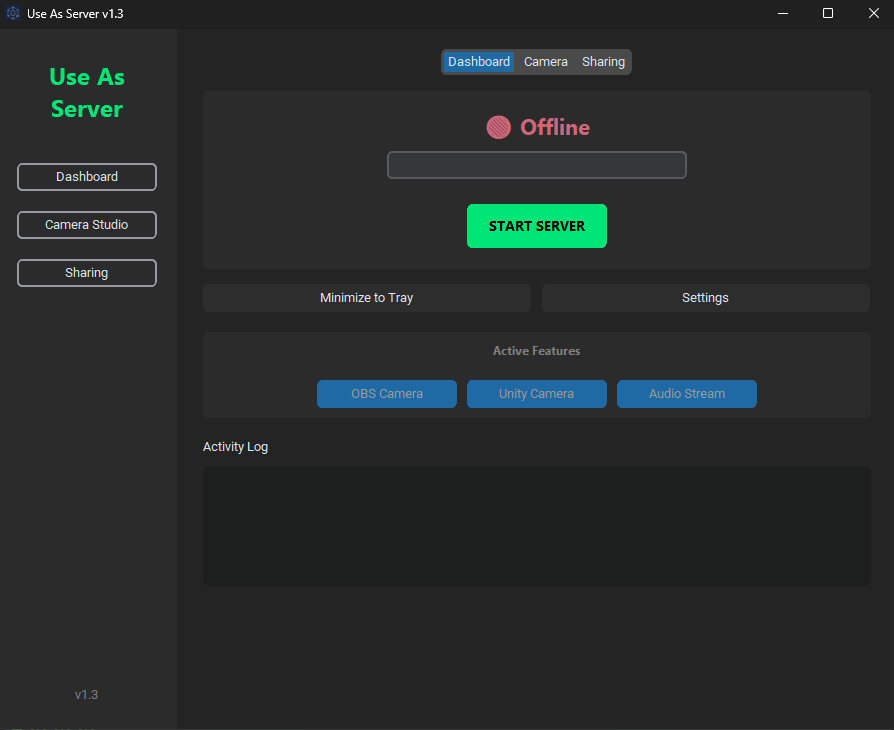
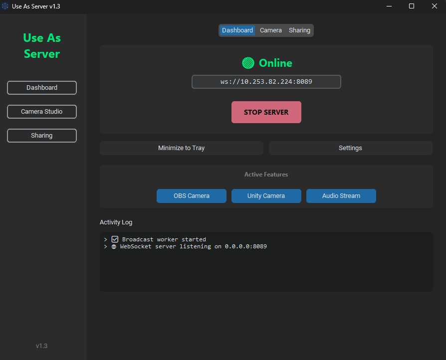
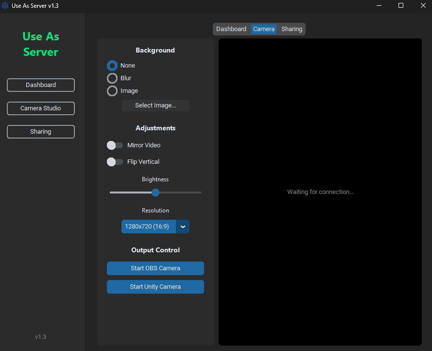
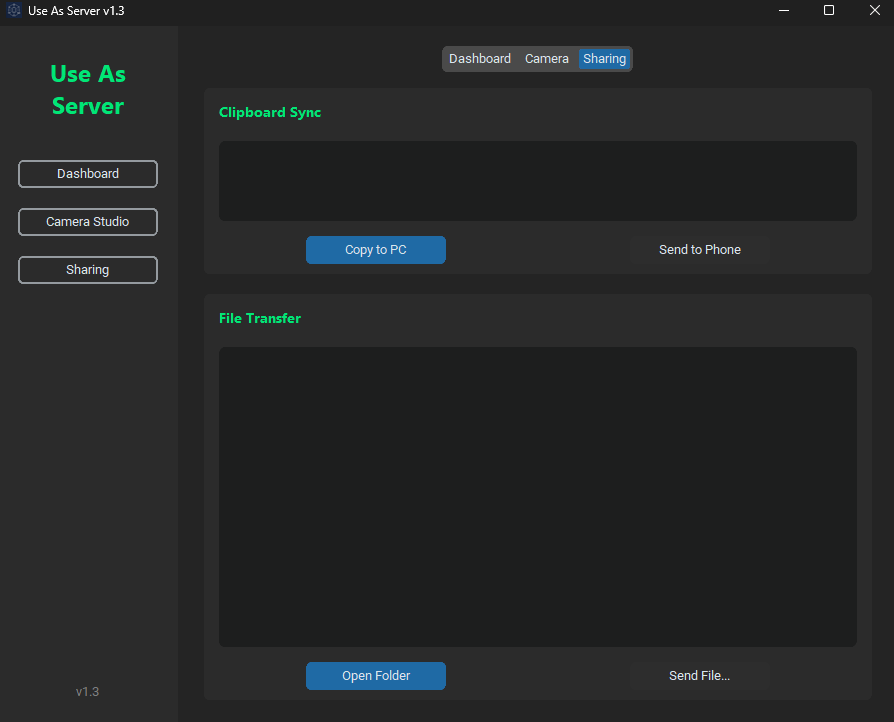
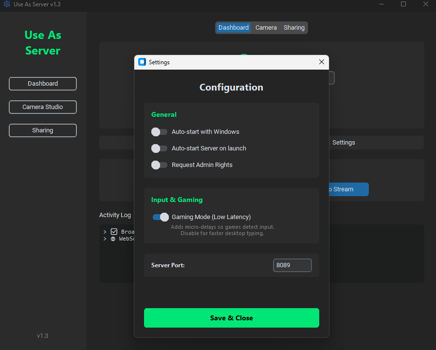

<div align="center">

# Use As Server 🖥️📱

**Turn your Android device into a suite of powerful PC peripherals.** Control your computer, stream video, extend your display, and use your phone as a microphone, webcam or speaker, all with low latency over Wi-Fi or USB.

[](LICENSE)
[]()
[](https://www.python.org/)
[](https://github.com/manjeetdeswal/Use-As-Server/releases/latest)

[**🌐 Visit Official Website & Guide**](https://manjeetdeswal.github.io/Use-As-Server/)

[**📲 Download Android App**](https://play.google.com/store/apps/details?id=com.jeet_studio.use_as)
<p align="center">
  
  
</p>
<p align="center">
  
  
</p>
<p align="center">
  
</p>


</div>

---

## ✨ Features

| Feature | Description |
| :--- | :--- |
| **🖱️ Smart Touchpad** | Smooth mouse control with acceleration, scrolling, three-finger gestures and multi-monitor support. |
| **⌨️ Full Keyboard** | Full layout with modifier support (Ctrl, Alt, Shift, Win/Cmd), macros and live text preview. |
| **🎮 Virtual Gamepad** | Emulates an **Xbox 360 controller** (Windows), a **uinput gamepad** (Linux), or maps to the keyboard (macOS). |
| **📹 Virtual Webcam** | Uses **OBS Virtual Camera** or **Unity Capture** (Windows), **v4l2loopback** (Linux) and **OBS Virtual Camera** (macOS). |
| **🎤 Wireless Mic** | Your phone's microphone becomes a microphone on the PC. |
| **🔊 PC Speaker** | Hear your PC's sound on the phone, with title, artist and cover of what's playing. |
| **🖥️ Second Display** | Extend your desktop to the phone. On Windows the phone becomes a real extra monitor. H.264 streaming for smooth 1080p60. |
| **📂 Files & Clipboard** | Send files both ways, browse and download the PC's files, and sync the clipboard (text and images) with history. |
| **🧰 PC Tools** | Shut down, restart, sleep or hibernate on a timer, per-app volume, screen brightness, open apps and switch windows, live PC stats. |
| **🎛️ Custom Buttons** | Stream-Deck-style buttons for shortcuts, apps, websites, folders and commands, with ready-made presets. |
| **🎞️ Presenter** | Next/previous slide, volume-key control, laser pointer and talk timer. |
| **🔔 Notifications & Calls** | See the phone's notifications and calls on the PC, and answer or decline them there. |
| **🔗 Easy Pairing** | Finds your PC automatically, or scan a QR code. Optional password. |
| **⚡ Low Latency** | Optimised for **5 GHz Wi-Fi** and **USB tethering**. |

> Some PC tools (per-app volume, the virtual monitor) are Windows only for now.
> The Android app can also control an **Android TV** (remote, keyboard, gamepad, screen and files) without this server.

---

## 📥 Installation

Download the server for your system from the [**Releases Page**](https://github.com/manjeetdeswal/Use-As-Server/releases/latest), or run it from the Python source.

| System | File |
| :--- | :--- |
| 🪟 Windows | `UseAs_Setup_v2.1.exe` (installer) or `UseAsServer_v2.1_portable.exe` |
| 🐧 Linux (x86-64) | `UseAsServer_v2.1_linux_x86_64.tar.gz` |
| 🍎 macOS, Apple silicon (M1 and newer) | `UseAsServer_v2.1_mac_arm64.dmg` |
| 🍎 macOS, Intel | `UseAsServer_v2.1_mac_x86_64.dmg` |

### 🪟 Option A: Windows

1.  Download and run **`UseAs_Setup_v2.1.exe`**.
2.  The installer sets up the **gamepad driver (ViGEmBus)**, the **virtual monitor driver** (optional, ticked by default) and the **Windows Firewall rules**.
3.  Launch **Use As Server** from the Start menu or desktop.

> [!IMPORTANT]
> **Extra drivers (only for these features)**
> * 🎤 **Microphone:** [Download VB-CABLE](https://vb-audio.com/Cable/)
> * 📸 **Webcam:** [Download OBS Studio](https://obsproject.com/) (or [Unity Capture](https://github.com/schellingb/UnityCapture))
>
> The server's **Setup** tab shows what's missing and has buttons to fix it.

The portable `.exe` runs without installing, but then the drivers and firewall rules aren't set up for you.

---

### 🐧 Option B: Linux

1.  Download **`UseAsServer_v2.1_linux_x86_64.tar.gz`** and unpack it:
    ```bash
    tar -xzf UseAsServer_v2.1_linux_x86_64.tar.gz
    chmod +x UseAsServer
    ```
2.  Install the tools it uses (Debian/Ubuntu shown; use `dnf` on Fedora):
    ```bash
    sudo apt install xdotool pulseaudio-utils playerctl xclip wmctrl
    ```
3.  Run it: `./UseAsServer`

4.  **Linux Setup & Configuration:**

    | Feature | Linux Setup |
    | :--- | :--- |
    | **📸 Camera** | `sudo apt install v4l2loopback-dkms` then<br>`sudo modprobe v4l2loopback devices=1 video_nr=10 exclusive_caps=1 card_label="UseAs Cam"` |
    | **🎤 Mic** | In your app (or `pavucontrol`), pick **"Monitor of UseAs_Virtual_Microphone"** as the microphone. |
    | **🎮 Gamepad** | Uses `uinput`. If it doesn't work: `sudo chmod 666 /dev/uinput` |
    | **📋 Clipboard images** | Needs `xclip` (X11) or `wl-clipboard` (Wayland). |
    | **🔥 Firewall** | If you use one, allow TCP 8080, UDP 8081 and TCP 8082. |

---

### 🍎 Option C: macOS

1.  Download the **`.dmg`** for your Mac (Apple silicon or Intel) and drag **`Use As Server.app`** into **Applications**.
2.  The app isn't signed yet, so the first time: **right-click the app › Open › Open**.

> [!IMPORTANT]
> **macOS Permissions & Drivers Required**
> Apple enforces strict security constraints. Please complete these steps for full functionality:
> * 🛡️ **Permissions:** Allow the app under `System Settings › Privacy & Security`: **Accessibility** (mouse and keyboard) and **Screen Recording** (second screen).
> * 🎤 **Microphone and 🔊 Speaker:** [Download BlackHole 2ch](https://existential.audio/blackhole/). For the phone mic, set your Mac's sound **Input** to BlackHole; to hear the Mac on the phone, set the sound **Output** to BlackHole.
> * 📸 **Webcam:** [Download OBS Studio](https://obsproject.com/). Open OBS and click "Start Virtual Camera" once to install its system extension.
> * 🖥️ **Display Extension:** [BetterDisplay](https://github.com/waydabber/BetterDisplay) can create a virtual display so the phone extends your desktop instead of mirroring it.

---

### 🐍 Option D: Run from Source (Advanced)

#### 1. Prerequisites
* **Python 3.10 to 3.12**.

#### 2. Install Dependencies

**Windows:**
```cmd
pip install -r requirements-windows.txt
```

**Linux:**
```bash
sudo apt install python3-tk python3-pip python3-venv portaudio19-dev xdotool pulseaudio-utils playerctl xclip wmctrl
python3 -m venv .venv
source .venv/bin/activate
pip install -r requirements-linux.txt
```

**macOS:**
```bash
brew install python@3.11 python-tk@3.11 portaudio
python3.11 -m venv .venv
source .venv/bin/activate
pip install -r requirements-mac.txt
```

#### 3. Run Server

The same command works on every system:

```bash
python UseAsServer.py
```

#### 4. Build it yourself

```bash
pyinstaller --noconfirm UseAsServer.spec
```

Build on the system you want the app for. Pushing a `v*` tag builds all of them on GitHub Actions and attaches them to a release. See [README_PLATFORMS.md](README_PLATFORMS.md) for details.
